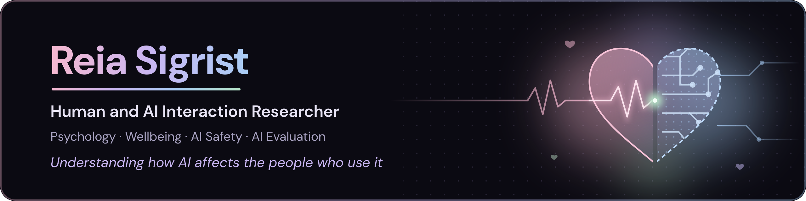
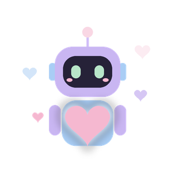
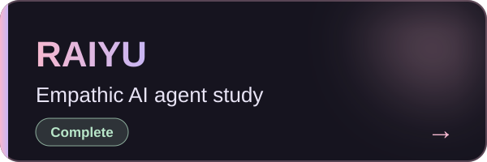
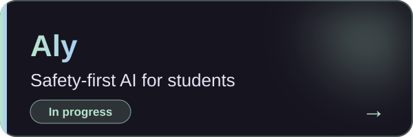
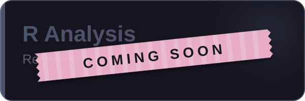
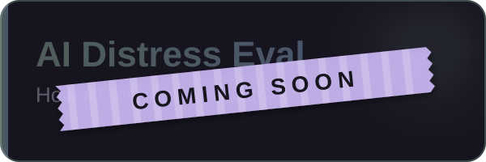

  

  
  
  

  
  
   
  

## About

Psychology researcher working where people and AI meet. I study how people experience AI systems, especially around wellbeing, and I'm building my skills in AI evaluation, Python and agent development.

✦ **Location** &nbsp; Swansea, Wales 
◈ **Education** &nbsp; MSc Applied Psychology (Distinction), BSc Psychology (First Class), UWTSD 
❖ **Background** &nbsp; Nearly 10 years in frontline care before moving into research 
⟡ **Focus** &nbsp; Human and AI interaction, wellbeing, AI evaluation 
◌ **Learning** &nbsp; Python, AI evaluation, Welsh 
✧ **Fun fact** &nbsp; [add yours here]

**Languages** &nbsp;

 

## Projects

  
  
  
  

## Stack

**Tools I use** 

**Research skills** 

**Learning** 

**Next up** 

## GitHub Stats

  
  

